# Doctor Tracker

Doctor Tracker provides invitation-based administrator access with mandatory MFA, a real doctor directory, complete patient management, Bangladesh-oriented registration, and a database-driven admin analytics dashboard. Search, combined filters, pagination, doctor assignments, editing, permanent deletion and analytics use the independent Express API and MongoDB.

Public source: **[akonBRO/doctor_tracker](https://github.com/akonBRO/doctor_tracker)**. Completed updates are committed and pushed to `origin` as requested by the owner. No deployment has been performed.

## Setup guide

Requires Node.js **22.16 or later**, npm with workspace support, and MongoDB Atlas or a local replica set. Ordinary standalone MongoDB does not support the transactions used to protect invitations, MFA completion, and refresh rotation.

```sh
npm ci
npm run setup:local
```

The setup command creates ignored `apps/api/.env` and `apps/web/.env` files with **independently generated random secrets**, preserving any existing files. They are for local development only. Environment examples contain descriptive placeholders, not live credentials.

**This workspace already uses Atlas:** retain `apps/api/.env`, its database selection and existing accounts. Connectivity was verified read-only during Stage 3. For ordinary development run `npm run dev`; do not run `dev:db`, reset, seed or replace the configured database. Automated tests provision separate disposable replica sets.

For a new installation, choose a database:

1. **Atlas / existing replica set:** set `MONGODB_URI` in `apps/api/.env`. Use TLS and a least-privileged database user. Never commit its connection string.
2. **Persistent Docker development database:** run `docker compose up -d --wait`. The supplied configuration initializes a local replica set and persists it in a named volume. It binds the unauthenticated development database to loopback only; it is not a production database configuration.
3. **Disposable local development database:** run `npm run dev:db` in its own terminal. It downloads a real MongoDB binary on first use, starts replica set `rs0` on port 27017, and removes the database when stopped. **Accounts and invitations are not retained.** This option needs no Docker or preinstalled MongoDB. Tests always use separate disposable databases.

Then start both apps:

```sh
npm run dev
```

Open **http://localhost:3000**. The independent API listens on port 4000. Visit `/api/v1/health` through the web origin or `http://127.0.0.1:4000/api/v1/health` directly for readiness.

Independent application commands:

```sh
npm run dev:web
npm run dev:api
```

### First administrator and subsequent invitations

With the database running and the API environment configured:

```sh
npm run invite -- your-email@example.com
```

This **privileged local CLI** displays a personal invitation link once. Open it privately, create your account using the exact invited email, then add the manual setup key to an authenticator app as a **time-based / 30-second / six-digit** account. Enter the current code, save your eight recovery codes privately, and enter the workspace.

Invitations are email-bound, single-use, and expire after 24 hours. No email service is configured: the operator shares links privately. There are no default users, passwords, demo logins, or public admin-provisioning endpoints. Opening `/signup` without an invitation explains the restriction.

The invitation token is in a URL fragment and removed from the address bar on load. If you reload before finishing registration, reopen the original invitation link. Do not put invitation links or recovery codes in issues, screenshots, CI logs, or commits.

### Environment configuration

| Application | Variable                     | Purpose                                                                          |
| ----------- | ---------------------------- | -------------------------------------------------------------------------------- |
| API         | `NODE_ENV`, `PORT`           | Development/test/production mode and independent API port                        |
| API         | `HOST`, `API_INSTANCE_COUNT` | Loopback by default; production requires one explicitly declared API process     |
| API         | `WEB_ORIGIN`                 | Exact approved frontend origin; no trailing slash                                |
| API         | `MONGODB_URI`                | Atlas or replica-set connection string; server-only secret                       |
| API         | `JWT_SECRET`                 | Independent 32-byte random key, encoded as 64 hex characters                     |
| API         | `MFA_ENCRYPTION_KEY`         | Independent 32-byte AES-GCM key, 64 hex characters                               |
| API         | `CSRF_SECRET`                | Independent 32-byte HMAC key, 64 hex characters                                  |
| API         | `ACCESS_TOKEN_MINUTES`       | JWT lifetime, default 5 minutes, maximum 15                                      |
| API         | `REFRESH_TOKEN_DAYS`         | Absolute refresh-family lifetime, default 7 days                                 |
| API         | `COOKIE_SECURE`              | `false` for local HTTP; **must be `true` in production**                         |
| API         | `TRUST_PROXY_HOPS`           | Exact count of trusted proxies, default 0; never blindly trust forwarded headers |
| Web         | `API_ORIGIN`                 | Server-only Express origin used by rewrites and server identity checks           |
| Web         | `APP_ORIGIN`                 | Public frontend origin; HTTPS enables HSTS and CSP upgrade policy                |
| Web         | `WEB_ALLOW_LOCAL_HTTP`       | Loopback-only production test opt-in; omit for deployment                        |

For production set both frontend origins to the same HTTPS origin and configure Secure cookies. Build the web app with the production `API_ORIGIN`: Next.js includes rewrite destinations in the build. No auth secrets use `NEXT_PUBLIC_` variables. Independently generate each key:

```sh
node -e "console.log(require('node:crypto').randomBytes(32).toString('hex'))"
```

See [security operations](docs/SECURITY.md) before rotating an MFA encryption key or configuring a production proxy.

## System architecture

```text
Browser
  │ public/auth pages + protected workspace
  ▼
apps/web · Next.js App Router · localhost:3000
  │ /api/v1/* → HTTP rewrite (same browser origin)
  │ protected server layout → identity check over REST
  ▼
apps/api · standalone Express · localhost:4000
  │ validation → origin/CSRF/rate checks → auth services
  ▼
MongoDB Atlas or replica set
  Admin · Invitation · Challenge · Session · Doctor · Patient
```

The frontend has no REST Route Handlers, Server Actions, database connection, signing keys, or sensitive authentication logic. Next.js handles rendering, navigation, headers, and the HTTP rewrite; Express owns all authentication and authorization. The API can run independently with an explicitly permitted frontend origin, although the supported browser deployment uses the same-origin proxy for host-only cookies.

```text
apps/
  api/src/
    config/       Environment validation and MongoDB lifecycle
    cli/          Trusted invitation provisioning
    middleware/   CSRF, cookie policy, unsafe-input rejection
    models/       Authentication, Doctor and Patient schemas/indexes
    services/     Authentication, record management and analytics
    tests/        Real database integration and security tests
    utils/        Cryptography, errors, privacy-conscious logging
    app.ts        REST endpoints, limits, HTTP security, error envelope
    server.ts     Independent HTTP startup and graceful shutdown
  web/src/
    app/          Public, auth, and protected route groups
    components/   Brand, navigation and application shell
    features/     Auth/MFA, Doctor/Patient management and dashboard
    lib/          Typed cookie-authenticated REST client
    styles/       Shared design tokens and responsive CSS
    proxy.ts      Per-request nonce CSP
packages/shared/  Runtime validation schemas and public API types
scripts/          Local secret configuration and disposable database
tests/e2e/        Production-browser workflow and accessibility tests
docs/             Stage status, security checklist, desktop/mobile evidence
```

## Technical decisions

### 1. Separate applications with a same-origin browser connection

Keeping Express independent follows the updated assignment architecture and gives authentication/database code a single owner. A Next.js rewrite lets the browser use host-only HttpOnly cookies without cross-site token handling. CORS still permits only the explicit frontend origin, and every mutation additionally validates the exact Origin and a signed CSRF token. The frontend uses a typed fetch client and a shared abortable no-store query hook. URL state controls directories; mutations refresh the relevant mounted view or navigate to a fresh record read.

### 2. Database-backed rotating sessions with mandatory MFA

A password creates only a five-minute pre-authentication challenge. Full access requires real TOTP verification or a single-use recovery code after password verification. Invitations, challenge completion, recovery consumption, and refresh rotation use MongoDB transactions to prevent concurrent use. Access JWTs live for five minutes, while opaque refresh tokens rotate within a fixed seven-day family lifetime. Every protected request checks the session and account in MongoDB, so logout and replay-family revocation take effect immediately. This trades a small indexed lookup for reliable revocation; it avoids relying solely on a JWT that remains valid after logout.

Passwords use Argon2id. MFA secrets use AES-256-GCM at rest. Invitations, refresh tokens, and recovery codes are stored only as hashes. Login errors do not reveal whether an email exists. No authentication material is stored in localStorage or sessionStorage. See the [endpoint contract and continuity notes](docs/IMPLEMENTATION_STATUS.md) and [security checklist](docs/SECURITY.md) for exact behavior and boundaries.

## Doctor Management — Stage 2

Use `/doctors` to browse the directory, `/doctors/new` to create a record, and `/doctors/[doctorId]` for practice/contact details. The form contains only name, specialization, hospital, phone and email. Contact fields are not unique; doctors do not receive login accounts. The original logo geometry and authentication flows are retained within the corrected light interface. Narrow screens use structured stacked records rather than a compressed desktop table.

| Method | Endpoint                    | Purpose                                                        |
| ------ | --------------------------- | -------------------------------------------------------------- |
| POST   | `/api/v1/doctors`           | Create a validated doctor; administrator + MFA + CSRF required |
| GET    | `/api/v1/doctors`           | Search/filter/sort/paginate actual records                     |
| GET    | `/api/v1/doctors/:doctorId` | Validated identifier, protected detail, safe 404               |
| GET    | `/api/v1/doctors/options`   | Bounded actual specialization/hospital suggestions             |

Directory parameters are `q`, `specialization`, `hospital`, `from`, `to`, `page`, `limit`, and `sort`. Search matches case-insensitive Unicode word prefixes across name, specialization and hospital, with up to five AND-combined words. Practice filters are exact normalized values. Creation-date filters use inclusive **UTC calendar days**, implemented as start-inclusive / next-day-exclusive timestamp bounds. Sorting supports `newest`, `oldest`, `name-asc` and `name-desc`, always with an `_id` tie-breaker. Page size is 1–50 (default 10); pages are 1–10,000. Query timeout is 3 seconds. An out-of-range page returns an empty array with accurate totals and the requested page, with a UI route back to page one.

The URL stores filters, sorting and page state; refresh/back/forward and validated return links preserve context. Input changes reset page one, while “Reset filters” preserves valid sort/page-size preferences. Reads debounce/cancel safely; writes have duplicate-submit protection and keep drafts on recoverable errors. No submitted mutation is automatically replayed.

Indexes cover creation order, normalized name order, individual/combined specialization/hospital filters and normalized multikey search tokens. The directory uses projected lean find/count queries; options alone use bounded distinct-value aggregation. Captured fixture query plans demonstrate index use without claiming production performance. See [Doctor Management](docs/DOCTOR_MANAGEMENT.md) for the schema, index definitions, exact API/date/search semantics, limitations, verification details, and implemented patient integration.

Successful browser tests use actual invitations/MFA/doctor APIs and an isolated MongoDB replica set. Only explicit failure/latency cases intercept responses. When a custom `.env` points the web app elsewhere, follow the [safe test-build origin instructions](docs/DOCTOR_MANAGEMENT.md#verification-and-local-execution): Next.js rewrite destinations are baked into the build, and the fixture refuses to target another API environment.

## Patient Management and redesign - Stage 3

Patient registration includes English/display and optional Bangla names, date of birth or explicitly approximate age, gender, blood group, mobile, optional email, validated Bangladesh division/district selectors, address, emergency contact and concise medical context. New records require name, condition, mobile, gender, age information and an actual assigned doctor. Older minimal records remain readable and editable without invented values. Unknown blood group and unknown allergies remain distinct from confirmed results; no NID is collected.

Create from a doctor profile or choose a doctor through actual database search. Directories preserve search, filters, sorting and pagination. Editing submits only changed fields, retains failed-save drafts and protects doctor assignment. Patient details separate identity, medical information, contacts and a clickable doctor link. Explicit permanent deletion removes the record from both directories.

The Stage 3 correction replaces the rejected composition with white navigation, sky-blue active states, a centered landing page, focused authentication, a task-based dashboard, a compact doctor profile and grouped registration forms. Inputs are 16px and labels 15px; Noto Sans Bengali is self-hosted alongside the existing typefaces. Narrow layouts use labeled records. No fake analytics or production seed records are included.

See [Patient Management](docs/PATIENT_MANAGEMENT.md) for endpoints, schema, scopes, indexing, deletion and Stage 4 integration; [Design Redesign](docs/DESIGN_REDESIGN.md) for the brief, references and visual review.

## Admin Dashboard — Stage 4

`/dashboard` displays exact all-time Doctor and Patient totals, current patients per doctor (including zero-patient doctors), and daily registration trends for the last 7, 30 or 90 UTC calendar days. Doctor names link to their real profiles. The distribution is explicitly paginated rather than presenting a top subset as every doctor. Deleted patients leave the totals, assignment counts and creation-date trends because there is no deleted-event ledger.

Three protected GET endpoints provide the data: `/api/v1/dashboard/overview`, `/api/v1/dashboard/patients-by-doctor`, and `/api/v1/dashboard/trends`. Express performs indexed counts/aggregation; only compact counts, date buckets and necessary doctor ID/name labels reach the browser. Patient personal/clinical fields are excluded. Existing authentication, MFA, sessions and shared-workspace authorization apply to every endpoint.

The light dashboard combines a two-value summary strip, a Recharts line chart with keyboard support and a daily-count table, and an accessible list with horizontal distribution bars. Period changes affect trends only. Reads cancel obsolete requests, retry independently and refresh on entry, explicit refresh, record changes and bounded visible-tab revalidation. No WebSockets, per-second polling or persistent analytics cache is added.

See [Dashboard Analytics](docs/DASHBOARD_ANALYTICS.md) for contracts, UTC/Bangladesh date semantics, query/index evidence, freshness, security, screenshots and limitations.

## Quality and readiness — Stage 5

Stage 5 retains the approved light UI and fixes reproduced availability, transport and keyboard-focus defects. Rejected mutations now consume the global abuse budget; deep JSON is inspected without recursion; known database outages return 503 promptly. Browser exchanges have bounded deadlines and safe malformed-response handling without replaying writes. Doctor selection/Escape returns keyboard focus to the search field.

The empty dashboard conditionally loads its chart: local cold-context JS transfer fell from 296,809 to 193,275 bytes. The complete self-hosted Bengali font now uses WOFF2, reducing observed font transfer from 305,670 to 244,604 bytes without glyph subsetting. Populated chart transfer has a small split-module overhead; API timing results were mixed. Existing indexes, offset pagination and no-store/freshness policy are retained on measured evidence.

See the [Stage 5 quality audit](docs/STAGE5_QUALITY_AUDIT.md) for page review, reproducible 200-doctor/4,000-patient measurements, all 20 security controls, accessibility and explicit limits. [Deployment Readiness](docs/DEPLOYMENT_READINESS.md) defines Stage 6 requirements. No deployment was performed and no persistent Atlas data or environment file was changed.

## Operational readiness - Stage 6

Production startup verifies indexes without creating them, requires safe TLS/origin/process configuration and checks web build/runtime rewrite compatibility. The API exposes readiness/liveness paths, drains active requests before shutdown, bounds HTTP/pool waits and logs sanitized connection/lifecycle events. Production API start consumes injected environment and requires production mode; it does not require a local env file.

Plain `npm run typecheck` uses a development-only route-type generation child, so unchanged local HTTP settings need no deployment configuration for typing. Production build/start still enforce the release validation rules.

The [Stage 6 evidence](docs/STAGE6_DEPLOYMENT_READINESS.md) explains the implemented safeguards and isolated HTTPS/MongoDB TLS/restore rehearsal. Use the [approval gate](docs/DEPLOYMENT_READINESS.md) and [production runbook](docs/PRODUCTION_DEPLOYMENT_RUNBOOK.md) for host/domain/TLS/secrets/backup decisions and explicit release approval. Push/CI never deploys this application. Existing Atlas data and environment files remain untouched.

## Scripts and verification

| Command                                                                 | Operation                                                                       |
| ----------------------------------------------------------------------- | ------------------------------------------------------------------------------- |
| `npm run dev`                                                           | Both apps, with independent processes                                           |
| `npm run dev:web` / `npm run dev:api`                                   | Run one application                                                             |
| `npm run dev:db`                                                        | Disposable real MongoDB replica set                                             |
| `npm run setup:local`                                                   | Create ignored local environments and strong random keys                        |
| `npm run invite -- email`                                               | Create a private one-time administrator invitation                              |
| `npm run typecheck`                                                     | Strict checks for apps, shared schemas, tests and tooling                       |
| `npm run lint`                                                          | ESLint; zero warnings permitted                                                 |
| `npm run format:check`                                                  | Check formatting                                                                |
| `npm test`                                                              | Security/integration tests with a fresh MongoDB replica set                     |
| `npm run build`                                                         | Shared package, Express and production Next.js builds                           |
| `npm run test:e2e`                                                      | Isolated Chromium tests on 3100/4100; use the test build origins below          |
| `npm run test:operations`                                               | Disposable HTTPS/TLS, compiled production startup, restore and outage rehearsal |
| `node scripts/test-e2e.mjs tests/e2e/quality.spec.ts --project=desktop` | Additional isolated 200-doctor/4,000-patient browser/performance/focus audit    |
| `npm audit` / `npm audit --omit=dev`                                    | Full / production vulnerability audits                                          |

For browser tests, install Chromium once:

```powershell
npx playwright install chromium
# PowerShell test-build environment; does not edit .env files
$env:API_ORIGIN = 'http://127.0.0.1:4100'
$env:APP_ORIGIN = 'http://127.0.0.1:3100'
$env:WEB_ALLOW_LOCAL_HTTP = 'true' # Explicit loopback-only production test opt-in
npm run build
npm run test:e2e
```

On Linux CI, use `npx playwright install --with-deps chromium`. Browser tests use dedicated 127.0.0.1 ports 3100 (web) and 4100 (API), reject occupied ports, verify their own API fixture identity and leave normal development on 3000/4000 running. Run the above environment commands in a separate test terminal; rebuild with normal origins before a regular production start. The browser runner starts each viewport/workflow with its own actual API/web processes and fresh isolated database, creates private test invitations, exercises real enrollment and refresh, checks responsive overflow and accessibility at 1440, 1024, 768, 375, and 320 pixels, then tears down its servers. This keeps the actual MFA/IP limits intact across independent auth/CRUD and dashboard workflows at all five widths. Test identities are disposable; they are never seeded into your configured database.

Set `E2E_WEB_MODE=development` to run the same browser suite against `next dev` and React Strict Mode, using an ignored separate `.next-e2e` build directory. In PowerShell, set `$env:E2E_WEB_MODE = 'development'` before running the suite, then remove that environment variable afterward. See the implementation status for the latest production and development verification results.

For local HTTP production-process debugging after a matching local build, retain the above loopback web opt-in and use these explicit local commands in separate terminals. Actual production uses injected variables and the approved release runbook:

```sh
npm run start:local -w @doctor-tracker/api
npm run start -w @doctor-tracker/web
```

Actual verification results and any unfinished checks are recorded in [IMPLEMENTATION_STATUS.md](docs/IMPLEMENTATION_STATUS.md).

`npm run test:operations` requires Chromium and OpenSSL (`openssl` on PATH, Git for Windows OpenSSL, or explicit `TEST_OPENSSL`). It creates only disposable TLS/HTTPS/database fixtures, exercises the compiled production API, builds Next with a temporary HTTPS origin, verifies auth/CRUD/restore/outage behavior, and tears down owned processes. Next performs its normal web env loading with fixture origins overriding local values. Rebuild with intended origins afterward; do not ship fixture `.next` artifacts.

## Visual evidence

The existing Stage 5 screenshots come from actual production-browser tests. Stage 6 leaves them unchanged because the UI is unchanged. Set `E2E_CAPTURE_SCREENSHOTS=true` only when intentionally regenerating images after a UI change. All identities and patient/doctor records shown are explicitly disposable test fixtures. MFA setup keys are masked before capture. No Atlas data is used.

| Desktop                                                                                            | Mobile                                                                                           |
| -------------------------------------------------------------------------------------------------- | ------------------------------------------------------------------------------------------------ |
| 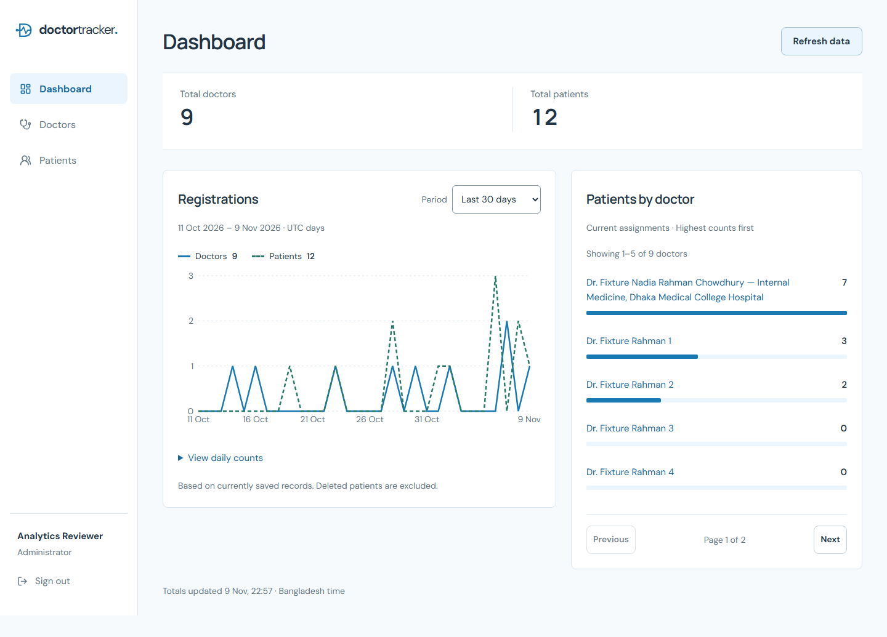                   | 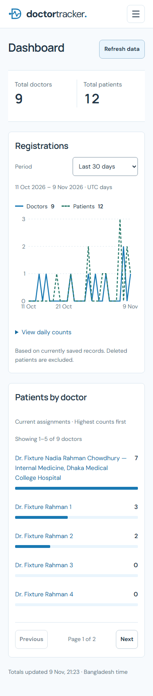                   |
| 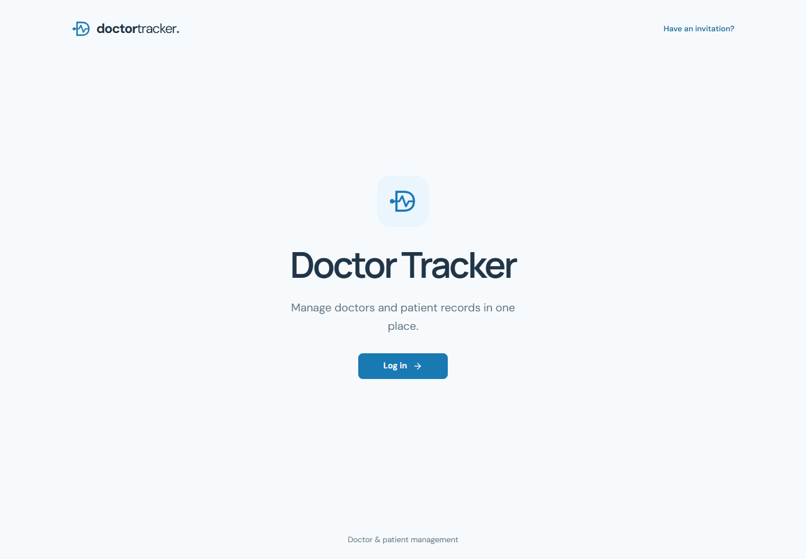                | 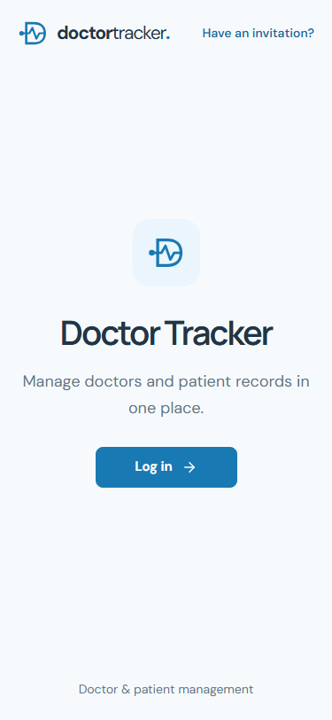                |
| 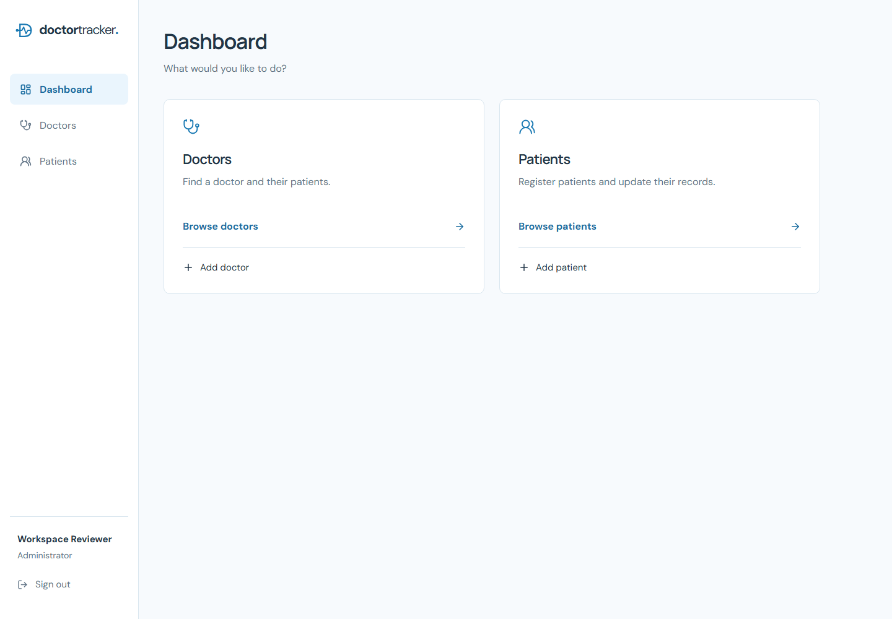                          | 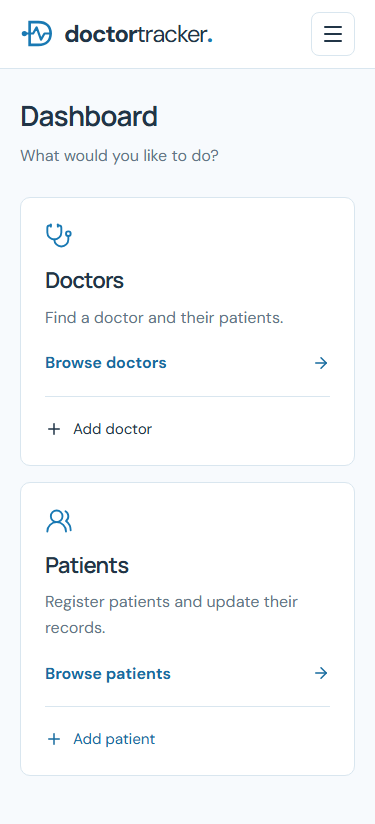                          |
| 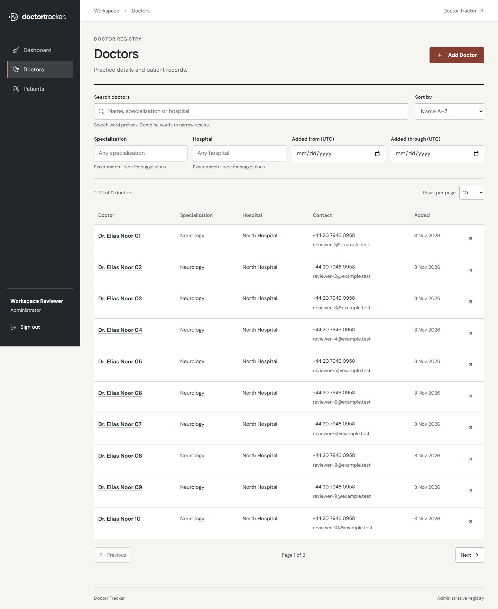 | 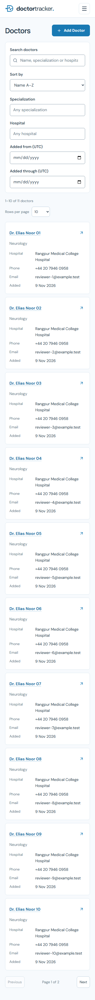               |
| 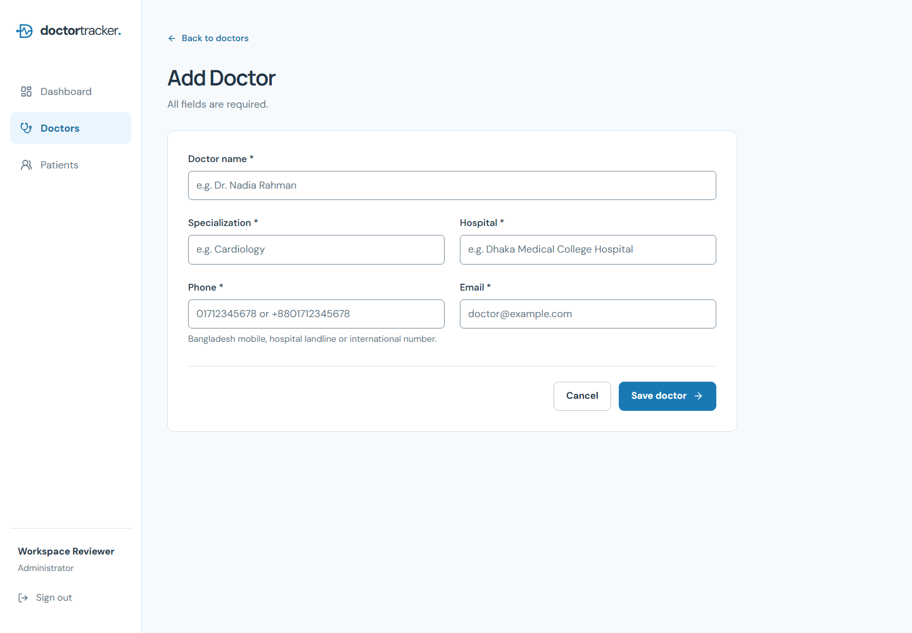                     | 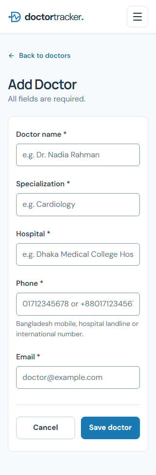        |
| 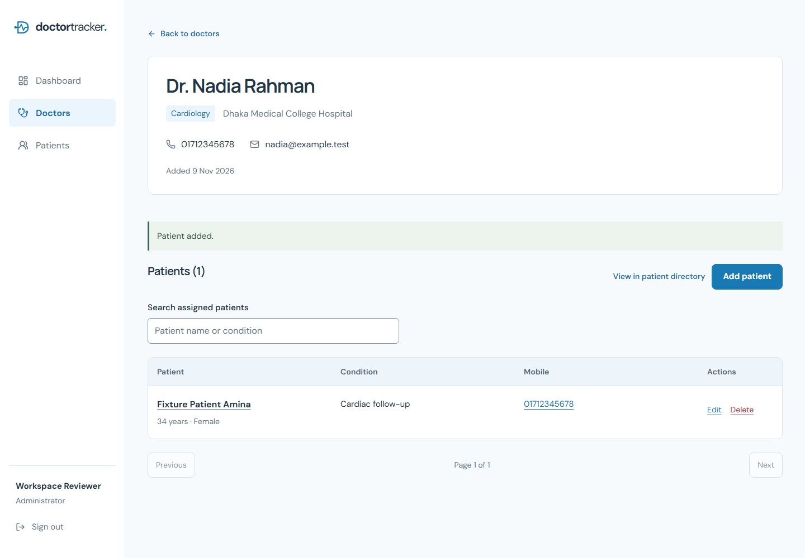                                | 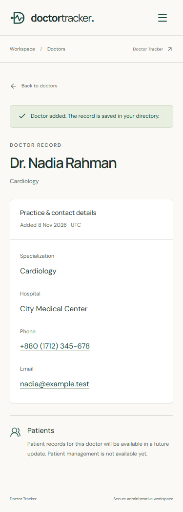 |

Patient screenshots: [directory](docs/screenshots/patients-desktop.png), [creation](docs/screenshots/patient-create-desktop.png), [detail](docs/screenshots/patient-detail-desktop.png), [editing](docs/screenshots/patient-edit-desktop.png), [320px directory](docs/screenshots/patients-small-mobile.png). The [design record](docs/DESIGN_REDESIGN.md) links every required page at all five widths.

## Current boundaries

Stages 1-6 provide authentication/MFA, redesigned public/auth/workspace screens, doctor creation and directory management, patient CRUD under validated doctors, aggregate dashboard reporting and measured quality refinements plus operational release safeguards. Doctors and patients are managed records, not login accounts. Doctor editing/deletion, patient reassignment, appointments, prescriptions and billing are outside this stage. Optional medical-history text provides registration context without introducing an EHR workflow.

Production deployment still requires explicit owner approval and the documented hosting/security/backup inputs. Atlas connectivity was verified read-only during the original Stage 3 delivery; Stages 4-6 use disposable verification databases only. No deployment, persistent database installation, email delivery, uploads, webhooks, password reset or MFA reset was performed. In-memory rate limits support one API instance; a shared store is required before scaling. Existing Atlas configuration and administrator data are preserved.
