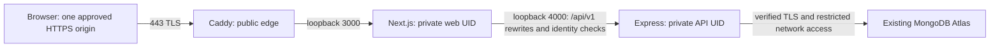

# Production infrastructure proposal

Prepared **10 November 2026**, for Stage 7 Phase A. This is a reviewed proposal and local test configuration, not permission to create resources. No host, domain, certificate, provider secret or production environment has been configured. The [approval gate](DEPLOYMENT_READINESS.md) must be completed first.

## Hosting comparison and recommendation

Prices are USD/month before tax, domain registration, Atlas, overages and operator time. Reconfirm the actual checkout and data-location requirements before purchase.

| Approach                                           | Region and recurring estimate                                                                                                                                                                                                                                                                       | TLS, operations and principal tradeoffs                                                                                                                                                                                                                                                                                                                                                                    |
| -------------------------------------------------- | --------------------------------------------------------------------------------------------------------------------------------------------------------------------------------------------------------------------------------------------------------------------------------------------------- | ---------------------------------------------------------------------------------------------------------------------------------------------------------------------------------------------------------------------------------------------------------------------------------------------------------------------------------------------------------------------------------------------------------- |
| **Recommended: one DigitalOcean Basic regular VM** | Singapore SGP1; 2 vCPU, 4 GiB, 80 GiB SSD, 4,000 GiB transfer: **$24**. Optional daily host backup: 30% = **$7.20**, total **$31.20**. These published rates were verified on the preparation date.                                                                                                 | Caddy terminates TLS; systemd supervises separate private Next/API processes. Low service count and explicit stop/start fit the current rate stores. Owner maintains OS/runtime patches, monitoring, recovery and availability. One VM is a single failure domain.                                                                                                                                         |
| Managed: Render web + private API                  | Singapore; two `1c-2g` instances (1 CPU/2 GB each), approximately **$25 each / $50 total**. The unit price is confirmed in Render's official hosting guide; $50 is the estimated two-service compute total. Reconfirm checkout, workspace/pipeline/network charges and private-service eligibility. | Managed TLS/process operations reduce host work; private API and same-origin Next routing still required. Default deployments overlap instances, including during restart, so they are **incompatible with the current independent memory rate stores**. Requires a verified serialized maintenance deployment procedure or a separately approved shared-store implementation. Not ready for this release. |
| Containers on the same VM                          | Same $24 compute / $31.20 with proposed host backup; registry, image storage and build costs additional if used. Singapore SGP1.                                                                                                                                                                    | Same Caddy/Next/API/Atlas boundaries and one-API restriction. Adds image/base-image lifecycle, registry and networking work without solving HA, Atlas backup or memory stores. No container configuration added; native services are simpler for this initial release.                                                                                                                                     |

Sources: [DigitalOcean compute prices](https://www.digitalocean.com/pricing/droplets), [regions](https://docs.digitalocean.com/platform/regional-availability/), [backup prices](https://docs.digitalocean.com/products/backups/details/pricing/), [Render pricing](https://render.com/pricing), [published 1c-2g price](https://render.com/articles/production-rails-hosting-guide), [compute plan names](https://render.com/docs/compute-plans), [regions](https://render.com/docs/regions), [deployment overlap](https://render.com/docs/deploys#zero-downtime-deploys). DigitalOcean's opt-in host [monitoring agent and alerts are free](https://docs.digitalocean.com/products/monitoring/details/pricing/); none is installed or configured here.

Singapore is a practical geographic candidate for Bangladesh, **an inference, not a latency measurement**. Both providers offer Singapore; DigitalOcean also lists Bangalore, not Mumbai. Lightsail lists [Mumbai and Singapore](https://docs.aws.amazon.com/lightsail/latest/userguide/understanding-regions-and-availability-zones-in-amazon-lightsail.html), an alternative if measured routing or residency favors India. No Bangladesh ISP-to-host or host-to-existing-Atlas measurements exist. Before approval, establish the existing Atlas region privately and measure representative RTT/read latency from the proposed region and Bangladesh. Do not move the existing database to improve this proposal without separate review.

The 4 GiB plan is a conservative starting proposal, not a capacity guarantee. Local process measurements appear in [Stage 7 evidence](STAGE7_PRODUCTION_DEPLOYMENT.md). Confirm limits, build headroom and actual workload on the approved host. Vertical scaling is an owner-approved paid operation. Horizontal scaling requires shared, independently namespaced stores for every rate budget and real proxy tests first. Kubernetes and Redis are not introduced for the present single-process design.

## Topology and network boundaries



- Ubuntu 24.04 LTS x86-64; one Next process and **one API process, including releases**. No PM2 cluster, replicas, overlapping deployments or direct public API. No application WebSockets are required; development HMR is not exposed.
- Public ingress: TCP 80 for canonical redirect/ACME and 443 for HTTPS. SSH only from the approved administrator network through key-based access. Default-deny other inbound ports at both cloud firewall and host firewall; ports 3000/4000/27017 are not public. Check IPv6 as well as IPv4. UDP 443 is optional; ordinary HTTPS uses TCP.
- API binds `127.0.0.1:4000`; Next binds `127.0.0.1:3000`. Fixed external path Caddy → Next → Express requires `TRUST_PROXY_HOPS=2`. Caddy replaces Host, X-Forwarded-Host/Proto/For, removes Forwarded, and accepts the canonical authority only. No CDN/load balancer or shorter public route is included. Adding one requires a new trust review and tests.
- Atlas uses a named database, verified TLS, restricted application credentials and the approved VM's egress address/network. Never add `0.0.0.0/0` as a convenience. Outbound DNS/SRV resolution, Atlas, HTTPS certificate/package endpoints and time synchronization must work. Do not hardcode rotating Atlas IPs.
- Pool maximum 10; server selection/connect 8s, pool wait 5s, socket 15s. Production auto-create/auto-index are disabled. Startup checks required existing indexes and readiness becomes unavailable during dependency loss. No schema/index/data change is part of release startup.

## Domain and TLS plan

Owner must supply the exact public hostname, DNS zone owner, TLS renewal contact and approved HSTS scope. After approval only: point A at the approved host; publish AAAA only if IPv6 ingress and firewall are tested. Review existing records before any change. No actual record or address is invented here.

`deploy/templates/Caddyfile` renders a single canonical HTTPS site and fixed-origin 308 HTTP redirects; unknown HTTP/HTTPS hosts receive 421 when TLS negotiation permits the request. Caddy automatically manages public certificates **only after an approved operator starts the real configuration with working DNS**. The local test uses its own temporary certificate, never ACME. Pin Caddy **2.11.9**, checksum-verified from the [official release](https://github.com/caddyserver/caddy/releases/tag/v2.11.9); update only through reviewed verification.

Generate a review file locally after the hostname/contact are supplied:

```sh
npm run infra:render -- --origin https://APPROVED_HOSTNAME --email APPROVED_TLS_CONTACT --out tmp/approved-infrastructure
```

Use `npm.cmd` for this forwarded-flag command in Windows PowerShell. Replace both placeholders; the command refuses unsafe origins, requires a public DNS hostname, and never installs/starts a service. It exclusively creates `Caddyfile` at the output path; it refuses overwrite. Production config syntax/ACME behavior must be validated again on the approved host. The edge has a 64 KiB body ceiling, 10s header / 30s body / 60s response / 60s idle limits and 3s upstream dial / 30s upstream-header deadlines. The API retains its stricter validation, request limits and existing body budgets. No authentication response or patient page is cached.

Next retains nonce CSP, HSTS, host-only Secure/HttpOnly/Strict cookies, frame/MIME/referrer protections and no public source maps. HSTS is the existing one-year `includeSubDomains` policy: the owner must confirm all affected subdomains support HTTPS before release. Do not request preload without a separate decision. Test certificate chain, renewal and expiry alerts on the real domain. [Caddy forwarding behavior](https://caddyserver.com/docs/caddyfile/directives/reverse_proxy) is explicitly constrained by the template; its admin API and persisted runtime config are disabled.

## Runtime identity, files and supervision

Templates in `deploy/systemd/` are for review and later approved installation. They are syntax checked without installation. They are based on [Ubuntu 24.04 systemd execution controls](https://manpages.ubuntu.com/manpages/noble/man5/systemd.exec.5.html).

| Path / process                                                | Ownership and permission plan                                                                                                                                                                                       |
| ------------------------------------------------------------- | ------------------------------------------------------------------------------------------------------------------------------------------------------------------------------------------------------------------- |
| `/opt/doctor-tracker/releases/FULL_SHA` and `current` symlink | Root owns final code/build/node_modules; directories 0755, ordinary files 0644 with intended package executables preserved. Runtime users cannot modify a release or the symlink. Keep previous known-good release. |
| `/etc/doctor-tracker`                                         | root:root 0755; no secrets in filenames. `api.env` and `web.env`: root:root **0600**, read by systemd before dropping privileges. Caddyfile root:caddy 0640. Never grant web access to API secrets.                 |
| API / web users                                               | Distinct `doctor-tracker-api` and `doctor-tracker-web` system users/groups, no login or sudo. A shared UID would defeat secret isolation through process access. Build/operator identities are separate.            |
| Web `.next/cache`                                             | Pre-create in each release, owned by web UID, mode 0700; only writable code-tree exception. No patient files or uploads are stored there.                                                                           |
| `/var/lib/caddy`                                              | caddy:caddy 0700, created by StateDirectory; protected ACME/certificate state, included in restricted host recovery policy.                                                                                         |
| Logs                                                          | Restricted system journal; choose bounded retention/storage, audit readers and disable forwarding to unapproved vendors. No public access log.                                                                      |

Units use `NoNewPrivileges`, strict read-only filesystem, hidden other-user processes, private tmp, empty application capabilities, kernel/control-group restrictions and limited address families. Caddy alone receives permission to bind low ports. Filesystem/proc/cgroup hardening must be checked on the actual host; local syntax checks do not prove enforcement.

Restart-on-failure is delayed 5s and bounded to three starts/60s; a healthy dependency must be restored before resetting failed units. API/web stop grace 20s exceeds the API's 10s shutdown ceiling; edge gets 30s. API MemoryHigh/Max **512/768 MiB**, web **1024/1536 MiB**, edge **192/256 MiB** are initial safety limits. OS, build workers and monitoring require additional headroom. An OOM/restart is an incident, not a successful health response. Build before stopping the running release and measure pressure; do not perform dependency installation as a runtime UID or root.

## Environment inventory and secure supply

Only placeholders are committed in `deploy/env/*.example`. Actual developer `.env` files remain unchanged and are excluded from packaging. Supply approved values from the owner's vault over a private operator channel directly into root-owned files, never chat, Git, shell history, CI variables/artifacts or frontend bundles. The repository stores no production secrets. `NEXT_PUBLIC_*` authentication/database variables are forbidden.

| Variable                                     | Owner; required/sensitive          | Format, validation and change policy                                                                                                                                                          |
| -------------------------------------------- | ---------------------------------- | --------------------------------------------------------------------------------------------------------------------------------------------------------------------------------------------- |
| `NODE_ENV`                                   | Both; required; no                 | `production`; API `--require-production` rejects other modes.                                                                                                                                 |
| `HOST`, `PORT`                               | API; explicit; no                  | `127.0.0.1`, `4000` in this topology. Review proxy and firewall on any change.                                                                                                                |
| `WEB_ORIGIN`                                 | API; required; no                  | Exact approved HTTPS origin, no path/trailing slash. Must equal web APP_ORIGIN. Exact CORS/CSRF checks retain their contract.                                                                 |
| `MONGODB_URI`                                | API; required; **yes**             | Existing Atlas credential, named database, SRV/verified TLS; no insecure TLS flags. Validate using startup without printing URI. Credential rotation is a separate reviewed operation.        |
| `JWT_SECRET`                                 | API; required; **yes**             | Existing independent 64 lowercase hexadecimal key. Strong/distinct checks at startup. Rotation changes access-token validity; incident response must also address refresh sessions.           |
| `MFA_ENCRYPTION_KEY`                         | API; required; **yes**             | Preserve the existing independent 64-hex key and recoverable escrow. Do not regenerate: existing encrypted MFA would become unreadable. Rotation requires a reviewed re-encryption migration. |
| `CSRF_SECRET`                                | API; required; **yes**             | Existing independent 64-hex key; rotation invalidates existing CSRF tokens. No automatic mutation retry.                                                                                      |
| `COOKIE_SECURE`                              | API; required; no                  | `true`; production rejects false. Host-only `__Host-` cookies remain Strict/HttpOnly/Path=/.                                                                                                  |
| `TRUST_PROXY_HOPS`                           | API; required; no                  | Exactly `2` for this fixed path. No arbitrary true or externally reachable shortcut. Revalidate client attribution after topology changes.                                                    |
| `API_INSTANCE_COUNT`, `WEB_CONCURRENCY`      | API; explicit; no                  | Both `1`. Do not set NODE_APP_INSTANCE; production rejects it. Host must prevent undisclosed second instances.                                                                                |
| `ACCESS_TOKEN_MINUTES`, `REFRESH_TOKEN_DAYS` | API; explicit default values; no   | `5` and `7`; validated ranges 1–15 and 1–30. Changing policy needs session/security review.                                                                                                   |
| `API_ORIGIN`                                 | Web build + runtime; required; no  | `http://127.0.0.1:4000`, server-only. Build/runtime rewrite must agree or startup rejects. Never embed API credentials.                                                                       |
| `APP_ORIGIN`                                 | Web build + runtime; required; no  | Exact approved public HTTPS origin; transport/header policy must match build.                                                                                                                 |
| `WEB_ALLOW_LOCAL_HTTP`                       | Web; optional; no                  | Omit or `false` in production. `true` only enables explicitly bounded loopback test origins.                                                                                                  |
| `NEXT_TELEMETRY_DISABLED`                    | Web/build; explicit; no            | `1`; no external telemetry added.                                                                                                                                                             |
| `NODE_TLS_REJECT_UNAUTHORIZED`               | Both; optional; no                 | Omit or `1`; never `0`. Custom test CA paths are not production inputs.                                                                                                                       |
| `XDG_DATA_HOME`, `XDG_CONFIG_HOME`           | Edge; explicit; state is sensitive | `/var/lib/caddy` via unit, protected certificates/account keys. Caddy does not receive API env.                                                                                               |

Safe validation reports field names and sanitized event codes, never values. No runtime test/profile env variables (`OPERATIONS_PROFILE_*`, fixture CA/DB values, E2E overrides) belong in these units. See [rotation procedures](SECURITY.md#secret-rotation).

## Approved-host preparation and release commands

**The following describes Phase B and has not been executed.** The owner must authorize provider/budget/domain/backup/operations first. A host operator installs a currently supported, exact Node 22 patch at `/usr/bin/node`, records Node/npm/OpenSSL/OS versions and checksums, and verifies that patch against the release. Local evidence used Node 22.16.0; this is not a recommendation to install an outdated patch. CI tests the maintained Node 22 line. A runtime update is part of the release verification, not an untested substitution.

1. Provision only the approved VM; apply OS updates, key-only scoped SSH, firewalls, time synchronization and administrator recovery access. Create the three non-login runtime users and a separate non-root build identity. Set up private operator/vault access. Restrict Atlas to approved egress only after a separately reviewed access change.
2. Obtain the exact approved source archive, `SHA256SUMS` and manifest. Verify SHA-256 and commit against the release record; inspect archive members before extracting under a new release directory. Run `npm ci --include=dev` as the build identity with NODE_ENV unset. Inject **only non-secret build origins**, run checks and build. Browser/operations checks overwrite `.next` with fixture origins: build the final release again with real approved origins **after** these tests.
3. Run production-only audit; optionally `npm prune --omit=dev` after all verification. Confirm workspace shared build, API dist, Next `.next`, public assets and required node_modules remain. Record hashes of the built output and build versions. Source archive is reproducible on the tested Git toolchain, not a claim of bit-identical Next output across OS/toolchains. This is not a prebuilt deployable binary.
4. Root finalizes release ownership, creates the writable web cache, injects separate mode-0600 env files, installs the reviewed Caddy binary/config and systemd units. Example installation operations, only on that approved host:

```sh
node scripts/fetch-caddy.mjs
sudo install -m 0755 tmp/tools/caddy/2.11.9/linux/caddy /usr/local/bin/caddy
sudo install -m 0644 deploy/systemd/doctor-tracker-api.service /etc/systemd/system/
sudo install -m 0644 deploy/systemd/doctor-tracker-web.service /etc/systemd/system/
sudo install -m 0644 deploy/systemd/doctor-tracker-edge.service /etc/systemd/system/
sudo systemd-analyze verify /etc/systemd/system/doctor-tracker-*.service
sudo -u caddy /usr/local/bin/caddy validate --config /etc/doctor-tracker/Caddyfile --adapter caddyfile
sudo systemctl daemon-reload
```

Configuration paths/users/release symlink must already exist with the reviewed permissions. Validation on a real hostname may initialize TLS storage; only execute after authorization. Never copy `.env` from the workstation. No implicit database index preparation, seed, user invitation or credential generation occurs.

5. Use the serialized release/rollback sequence in the [deployment runbook](PRODUCTION_DEPLOYMENT_RUNBOOK.md). Enable services at boot only after initial smoke checks and owner acceptance. No automated deployment workflow exists. Before future automation, create a protected GitHub production environment, required reviewers, scoped credentials and an explicit full-SHA manual gate. The repository API currently lists **zero environments**; protection is not already enforced.

## Monitoring proposal and ownership

Opt-in host metrics plus restricted journal collection are sufficient initially; no paid monitoring service is needed for this proposal. The owner must name an incident recipient, backup operator, TLS/DNS owner and patching operator. No alert delivery has been tested.

| Signal                 | Proposed initial threshold / action, to tune on the host                                                                                                                                              |
| ---------------------- | ----------------------------------------------------------------------------------------------------------------------------------------------------------------------------------------------------- |
| Availability/readiness | Private probes every 30s; alert after three failures; distinguish 429 from 503. Liveness is separate from database readiness. Do not publicly increase API probe traffic or exhaust budgets.          |
| API 5xx / latency      | >1% over 5 min with ≥20 requests; investigate request IDs and dependency/resource events; establish a real p95 baseline before setting latency SLO.                                                   |
| CPU / memory           | CPU >85% for 5 min; sustained MemoryHigh, any OOM or repeated restart: inspect, throttle approved ingress or rollback; do not weaken auth limits.                                                     |
| Disk / log size        | 80% warning / 90% critical; journal retention initially 7 days / 256 MiB cap subject to privacy policy. Preserve necessary sanitized incident evidence.                                               |
| Restarts / dependency  | Any crash loop/failed unit, shutdown deadline or prolonged DB disconnect: page incident owner; bounded restart does not repair Atlas.                                                                 |
| Authentication         | Named login/MFA/refresh/logout rejection codes and 429 trends; investigate without logging account identifiers, URLs, tokens or patient data. Do not treat routine unauthenticated `/me` as an alert. |
| TLS / backup           | Certificate expiry <21 days or renewal failure; missed backup/recovery-point target or failed restore drill: page responsible owner and block risky release.                                          |

Application logs contain request ID/method/status/duration and named lifecycle/security events only. Edge access logging is disabled; its global runtime log deletes request and response-header objects, including on upstream errors. A fixture verifies a URL/query/cookie/authorization sentinel is absent from edge failure logs. Review host/provider logs separately. The [Caddy log filter](https://caddyserver.com/docs/caddyfile/directives/log) is privacy preparation, not a guarantee about all provider logging or legal compliance.

Until the actual host is approved, patching, metrics/alerts, DNS/renewal, filesystem isolation, resource enforcement and public-path verification remain unperformed. Backup ownership and restore acceptance are defined separately in the [backup runbook](BACKUP_RECOVERY_RUNBOOK.md).
