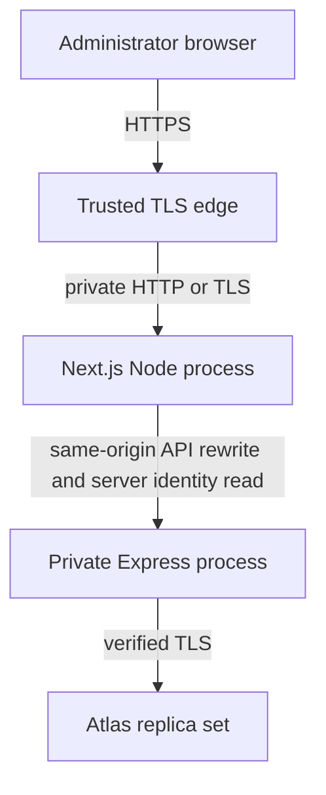

# Stage 6 implementation and verification

Started from `a623f0ae60235326c7d72f1e3d596f4796e57e8c` on clean, synchronized `main`. This stage prepares the existing application for an approved release. **Nothing was deployed, provisioned, purchased, or changed in live DNS, Atlas, hosting, credentials or GitHub secrets.** Existing API/web environment files are checked for byte-for-byte preservation without displaying their contents.

## Baseline and priorities

Stage 5 already delivered the working light UI, auth/MFA, doctor/patient management, analytics, 214 tests, 15 production browser checks and the asset reductions. Those results are historical. This stage retains the architecture, logo, schemas, record contracts, indexes, query/pagination policy, conditional chart loading and full WOFF2 Bengali font.

The initial review covered README, implementation status, Stage 5 audit, deployment readiness, security, record/analytics/design documentation, source/configuration, scripts, environment examples and CI. It found these provider-independent gaps:

| Priority                  | Finding                                                                                                                     | Implemented resolution                                                                                                                                                                                                            |
| ------------------------- | --------------------------------------------------------------------------------------------------------------------------- | --------------------------------------------------------------------------------------------------------------------------------------------------------------------------------------------------------------------------------- |
| High operational risk     | API startup ran `createIndexes()` even in production. A routine restart could initiate database changes.                    | Production disables automatic collection creation and verifies required indexes. Missing/incompatible indexes fail startup. An explicit privileged preparation command is separate from startup; it never syncs or drops indexes. |
| High configuration risk   | Web production could fall back to local API/public origins; runtime identity fetches could disagree with the baked rewrite. | Explicit production origins, HTTPS public origin and validation at config loading; startup rejects API rewrite or HTTP/HTTPS security-header drift. Local HTTP is an explicit loopback-only test opt-in.                          |
| High deployment risk      | Memory rate stores had no declared replica/process guard.                                                                   | Production requires explicit `API_INSTANCE_COUNT=1` and proxy hops; larger counts, incompatible hosting concurrency and PM2 instance variables are rejected. There is no distributed store claim.                                 |
| Moderate security risk    | Production MongoDB URI validation did not require verified TLS or a named database.                                         | Require SRV/default TLS or explicit TLS, reject verification bypasses, force TLS in the production driver and reject global TLS-disable settings.                                                                                 |
| Moderate reliability risk | HTTP defaults, shutdown failure paths and production-like proxy/cookie behavior lacked direct operational evidence.         | Explicit HTTP/pool bounds; reusable draining lifecycle, dependency-aware readiness, independent liveness semantics, sanitized connection events, real TLS/proxy/auth/restore rehearsal and Linux signal checks in CI.             |
| Release usability         | API start required a local `.env` file even with secret-manager injection.                                                  | Production start consumes injected environment and requires production mode; explicit `start:local` retains env-file behavior.                                                                                                    |

The prioritized work was configuration/index safety, lifecycle/transport tests, recovery rehearsal, then release documentation and complete regression/CI verification. No provider decision was needed to implement these changes.

## Recommended deployment architecture

Use one HTTPS browser origin, one Next.js Node process and **one Express process** behind a trusted edge, with Atlas accessed over verified TLS. Keep the API on loopback for a same-host installation or on an explicitly isolated private network. Hosting remains the owner's decision.

Same-origin `/api/v1/*` preserves the existing relative client URLs, `credentials: same-origin`, Strict/HttpOnly host-only `__Host-` cookies and exact Origin/CSRF policy. Separate private hosting for Next/Express is compatible if the private API transport and proxy chain are protected. A separate **browser-facing API subdomain** would require cookie/client/CSRF changes and adds no demonstrated benefit; it is not the release design.

No real domain or paid provider has been selected. A static export is unsuitable because protected layouts, nonce CSP and HTTP rewrites need a running Next server. The existing Docker Compose file is a loopback-only unauthenticated **development database**, not a production deployment template.

## Environment and secret inventory

All values are injected by the chosen host/secret manager. Existing `.env` files remain local and untouched. `.env.example` contains development examples and comments only.

| Component  | Variable                                                                   | Release requirement                                                                                                                                                                                             |
| ---------- | -------------------------------------------------------------------------- | --------------------------------------------------------------------------------------------------------------------------------------------------------------------------------------------------------------- |
| API        | `NODE_ENV`                                                                 | `production`; production `start` refuses another/absent mode.                                                                                                                                                   |
| API        | `HOST`, `PORT`                                                             | Default loopback / 4000. Container binding requires explicit private-network protection; accepted bind addresses are documented in the example.                                                                 |
| API        | `WEB_ORIGIN`                                                               | Exact public HTTPS origin, no path/trailing slash/userinfo.                                                                                                                                                     |
| API        | `MONGODB_URI`                                                              | Named database, transaction-capable cluster, verified TLS. SRV defaults to TLS; ordinary URIs require `tls=true` or `ssl=true`. Verification bypasses are rejected. Credentials/network access are server-only. |
| API        | `JWT_SECRET`, `MFA_ENCRYPTION_KEY`, `CSRF_SECRET`                          | Three independent strong 32-byte hex values. Preserve the existing MFA encryption key. Rotation follows the security runbook and is not performed here.                                                         |
| API        | `COOKIE_SECURE`                                                            | `true`; cookies use Secure, HttpOnly, Strict, Path=/, no Domain and `__Host-` names.                                                                                                                            |
| API        | `TRUST_PROXY_HOPS`                                                         | Required explicit fixed hop count in production, 0–3. Determine from the actual protected network path; never trust all headers.                                                                                |
| API        | `API_INSTANCE_COUNT`                                                       | Required explicit `1`. Declared larger counts fail. `WEB_CONCURRENCY`, if set, must be `1`; PM2 instance variables are rejected.                                                                                |
| API        | `ACCESS_TOKEN_MINUTES`, `REFRESH_TOKEN_DAYS`                               | Existing bounded defaults: 5 minutes / 7 days, maximum 15 minutes / 30 days.                                                                                                                                    |
| Web        | `API_ORIGIN`                                                               | Explicit server-only HTTP(S) origin at build **and** start. Private HTTP requires an actually trusted network. Startup checks the built rewrite.                                                                |
| Web        | `APP_ORIGIN`                                                               | Explicit public HTTPS origin at build/start. HSTS and CSP upgrade behavior must match the build.                                                                                                                |
| Web        | `WEB_ALLOW_LOCAL_HTTP`                                                     | Omit/false for release. `true` permits production-build testing only when **both** origins are loopback; remote origins cannot opt out of HTTPS.                                                                |
| Both       | `NODE_TLS_REJECT_UNAUTHORIZED`                                             | Never `0`; production validation rejects TLS disablement. Use a trusted CA configuration instead.                                                                                                               |
| Tests only | `E2E_WEB_MODE`, `E2E_CAPTURE_SCREENSHOTS`, `QUALITY_PHASE`, `TEST_OPENSSL` | No release configuration role. Screenshot generation requires explicit `true`; Stage 6 keeps the existing images because the UI did not change.                                                                 |

API errors identify configuration field names without logging values. No signing/encryption/database variables are browser exposed. No new runtime dependency or authentication store is introduced. Git ignore/history review is recorded in verification; absence of a selected scanner match is not proof that a public history can never contain a secret.

## API/database operations

- **Production start:** `npm run start -w @doctor-tracker/api` reads injected variables and requires production mode. `npm run start:local -w @doctor-tracker/api` explicitly reads the local env file for local production-process debugging. Normal `npm run dev` is unchanged.
- **Readiness:** `GET /api/v1/health/ready` and compatibility alias `/api/v1/health` return 200 only when connected and not draining, otherwise 503 with generic status. **Liveness:** `/api/v1/health/live` reports the running HTTP process independently of MongoDB. All retain no-store, input/CORS protections and the existing global budget; use low-frequency private probes and verify their rate budget at the host.
- **Shutdown:** signals mark the service draining, stop accepting connections, wait for active responses, then disconnect MongoDB. Repeated shutdown shares one promise. Failure/ten-second deadline exits nonzero and closes active connections. The supervisor must allow more than ten seconds and drain edge traffic first. Shared lifecycle behavior is tested locally; actual SIGTERM/SIGINT process behavior is tested on Linux CI, not claimed on Windows.
- **HTTP bounds:** 16KiB header budget, 100 headers, ten-second headers timeout, 30-second request/socket inactivity bounds and five-second keep-alive. These do not constitute an application transaction cancellation guarantee or replace edge slow-client controls.
- **Pool bounds:** maximum ten/minimum one connection, eight-second connection/server selection, five-second pool wait and 15-second socket inactivity. Existing three-second directory/analytics query budgets and 15-second browser exchange deadlines remain. Never automatically replay uncertain writes.
- **Connection events:** sanitized disconnected/reconnected/error and draining/stopped/deadline events complement request ID/method/status/duration logs. No URL, body, credential, raw DB error or patient field is attached.
- **Indexes:** routine production start does not create/sync/drop indexes. The privileged `db:prepare -- --apply-indexes` command is an explicit release action requiring owner/operator approval and a verified target/backup. It only creates required indexes; conflicts fail for manual review. No schema/index change is required by Stage 6 for the existing database.

An operator's declared process count cannot detect an undisclosed second machine. Hosting must enforce one API instance, including during deployments; rolling overlap is not supported by memory budgets. Restart resets those budgets. Shared, namespaced stores and a tested rollout are required before horizontal scaling. Redis is not added or required for local development.

## Verification status

| Status                                         | Evidence / boundary                                                                                                                                                                                                                                                                                                           |
| ---------------------------------------------- | ----------------------------------------------------------------------------------------------------------------------------------------------------------------------------------------------------------------------------------------------------------------------------------------------------------------------------- |
| Implemented and verified                       | Configuration rejection tests, secure-cookie/proxy budgets, readiness/liveness/draining, active-response draining and deadline/error cases; existing security/CRUD/analytics regressions retained. Final counts/commands are in Implementation status.                                                                        |
| Implemented and verified in isolated rehearsal | `npm run test:operations`: generated temporary CA/certificate, actual production API, verified MongoDB TLS bridge, HTTPS edge, actual Next build/start, real browser invitation/MFA/refresh/CRUD/analytics/logout, restore and outage/recovery. Only program-created disposable MongoDB can be targeted.                      |
| Exercised with a stated simulation boundary    | Browser accepts the temporary self-signed certificate for the local fixture; a Node HTTPS client and MongoDB driver separately validate the explicit CA. The fixture's MongoDB TLS bridge terminates before the local disposable database. This is not an Atlas TLS/network/failover test or a final public certificate test. |
| Exercised partially                            | BSON documents/index metadata are restored into a separate disposable database; relationships, dates/IDs, encrypted MFA and actual recovery login are checked. No durable Atlas snapshot, point-in-time recovery or `mongodump`/`mongorestore` tool execution is claimed.                                                     |
| Documented but not exercised                   | Release/rollback/incident procedures, monitoring thresholds, backup retention and operational access controls in the runbook.                                                                                                                                                                                                 |
| Blocked by missing decisions/access            | Hosting, public origin/DNS, real TLS edge topology, secret manager, Atlas tier/backup capabilities, backup owner and approved RPO/RTO. No infrastructure access is requested to complete repository work.                                                                                                                     |
| Requires manual production verification        | Actual public HTTPS/cookies/CORS/CSP, proxy spoofing/IP attribution, resource sizing, production graceful draining, Atlas permissions/TLS/restore, monitoring delivery and security/privacy acceptance.                                                                                                                       |

## Frontend, security and release limits

No UI or branding change was needed. Existing five-width browser flows and larger-fixture quality checks are rerun; no screenshots are regenerated. Conditional chart loading, font glyphs/license, server pagination, bounded requests, projections, cancellation and no-store freshness remain. No broad new cache, cursor contract, index or telemetry service is added. Local timings are not a production capacity guarantee.

The Stage 5 20-control matrix remains applicable. Stage 6 adds production-specific TLS/origin/process/index/shutdown tests. Uploads, webhooks, arbitrary user-URL fetchers, patient/doctor login and public account-reset/provisioning APIs remain absent. All administrators share one workspace; production network/DB authorization and future tenancy are separate responsibilities.

The existing workflow remains verification-only: deterministic `npm ci`, typecheck, lint, format, tests, production build, Chromium flows, quality/operations checks and both dependency audits. No deploy-on-push workflow, hosting integration, cloud resource or GitHub secret is created. Any later automated deployment must use an explicit approval gate approved by the owner first.

Use [Production Deployment Runbook](PRODUCTION_DEPLOYMENT_RUNBOOK.md) for release, monitoring, backup/restore, rollback and incident response. [Deployment Readiness](DEPLOYMENT_READINESS.md) is the compact approval gate; [Implementation status](IMPLEMENTATION_STATUS.md) records actual executed results and the final handoff reports exact-SHA CI.
